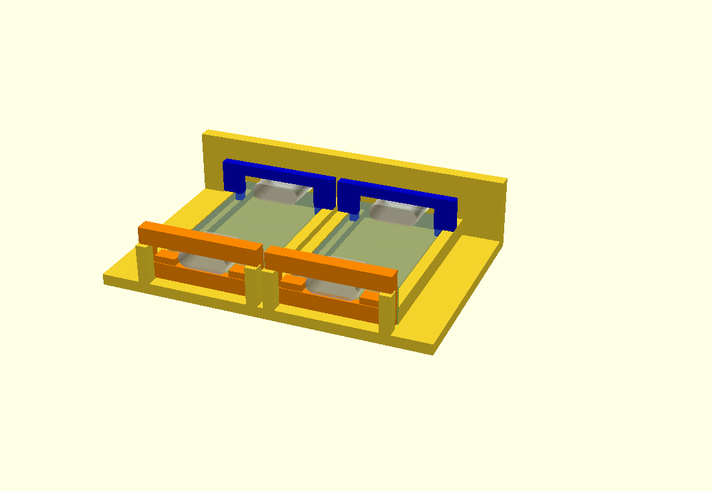
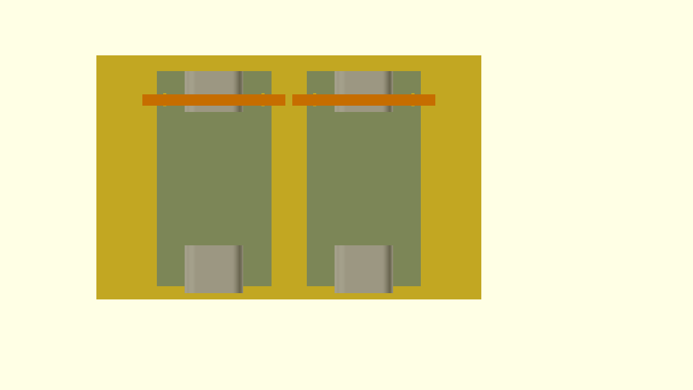

# Enclosure

## Status

| Part | State |
|---|---|
| Two-port USB-C wall + cradle **test coupon** (`usb_wall_test.scad`) | Models and checks pass. **Cannot be finalised until the boards arrive**: three dimensions need calipers. |
| Full enclosure | Not started. Waits on the coupon results. |

**Layout decision:** both input ports side by side on one face; the ESP32's own USB-C stays inside (`docs/decisions.md`).

## Board dimensions in hand

| Board | Size | Source |
|---|---|---|
| Waveshare RP2350-USB-C (×2) | 33.00 × 17.50 mm, R2.00 corners. USB-C 8.90 mm wide, centred, **at both ends** | Waveshare dimensioned drawing (verified) |
| Waveshare ESP32-DEV-KIT-WROOM-32E-N4 | 53.80 × 27.94 mm. Four mounting holes at 50.04 × 25.40 mm centres. 19-pin headers, 2.54 mm pitch, 45.72 mm span, rows 24.94 mm apart. USB-C 8.95 mm wide on one short edge; **PCB antenna at the opposite end** | Waveshare dimensioned drawing (verified) |

Rough full-box estimate from those: the ESP32 sets the width, so about **62 × 72 × 20 mm** outside, boards flat, input ports on one short face. That is an estimate, not a model.

**Antenna rule:** the ESP32's antenna end must point at a wall with no wiring, no diodes and no USB cables crowding it, and no carbon-fibre-filled filament anywhere near.

## Test coupon



**What it's for:** a small print (about 59 × 39 × 13 mm) to check the port design before the full box.

- Do the USB-C shells line up with the wall openings?
- Do real cables seat fully?
- **Do two cable overmolds fit side by side?** This is the main risk of the chosen layout and the reason the coupon prints both ports.
- Do plug-in and pull-out forces go into the printed parts instead of the boards' solder joints?

**How it holds each board:**

| Force | Taken by |
|---|---|
| Pull-out (cable yanked outward) | The board's front edge presses against the wall's inside face |
| Push-in (plugging in) | The drop-in clip (`key`), bearing on the whole PCB back edge |
| Up/down wiggle, front | The USB shell sitting in the wall opening |
| Up/down, back | The clip's two corner lips over the board top |
| Side to side | Cradle side rails, flush with the board top so the castellated pads stay reachable for soldering |

**The clip has a window.** This board has a second USB-C connector on its inner end, so a plain bar would hit it. The clip is clear from the board top up to above the shell, and solid below, which lets it bear on the full PCB edge rather than just two corners.



**Not tested here:** blocking that inner port. It is live on the board's `5V` net (`hardware/wiring.md`), so the full box must make it unreachable. The coupon leaves it open so the fit can be inspected.

## Before printing: measure three values

None of these is in Waveshare's drawing. Calipers on a real board settle them.

| Parameter in `usb_wall_test.scad` | Current value | What to measure |
|---|---|---|
| `pcb_t` | 1.60 mm (assumed) | Board thickness, away from any parts |
| `usb_h` | 3.26 mm (typical top-mount shell) | USB-C shell height, board top to shell top |
| `usb_over` | 1.03 mm (the QT Py's value) | How far the shell overhangs the board edge |
| `under_clear` | 1.5 mm (assumed) | Tallest part on the board's underside, if any |

After editing them:

1. Run `tests/check_fit.sh`. Every line should say `ok`, `clear` or `contact only`, and the exit code should be 0.
2. Re-export both parts:

   ```
   openscad -o stl/usb_wall_test_coupon.stl -D 'part="coupon"' usb_wall_test.scad
   openscad -o stl/usb_wall_test_key.stl    -D 'part="key"'    usb_wall_test.scad
   ```

   The checks read the board numbers from the model itself through `p_*()` accessors, so there is nothing to keep in sync by hand.

## Printing

| Setting | Suggestion |
|---|---|
| Files | `stl/usb_wall_test_coupon.stl`, `stl/usb_wall_test_key.stl` (**print two keys**) |
| Orientation | As exported. The coupon sits on its base; each clip lies on its back with the lips up. |
| Supports | None. The port openings and pockets are short bridges. |
| Material | PLA or PETG for the test. **Not** carbon-fibre-filled (that rule matters most near the antenna in the final box). |
| Layer height | 0.12–0.16 mm gives cleaner port openings; 0.2 mm is fine for a first look. |
| Walls | 3 or more perimeters |

## Test steps

1. Lower a board into a cradle about 1.5 mm back from the wall.
2. Slide it forward until the USB shell enters the opening and the board edge touches the wall.
3. Drop a clip into the two slots behind it, with the inner connector passing through the clip's window.
4. Repeat for the second board.
5. Plug in several different cables, including your thickest-housing one. Check each:
   - Does it click fully in?
   - Does the board move?
   - Does the plug housing hit the wall before the plug is fully in?
6. **Plug both ports at once with your two fattest cables.** Do the housings foul each other?
7. Wiggle a plugged-in cable up, down and sideways. Watch whether the board flexes.

## Tuning parameters

| Symptom | Change |
|---|---|
| Two cables foul each other at the wall | `pitch_extra` (default 3.0). Raising it widens the box |
| Board too tight or loose in the cradle | `fit` (default 0.20 per side) |
| Shell binds in the opening, or the gap looks sloppy | `hole_c` (default 0.25 per side) |
| Plug housing hits the wall before the plug is fully in | Raise `om_w` / `om_h` (13.0 × 7.2), or set `mouth_recess` negative |
| Clip too tight or loose in its slots | `key_fit` (default 0.15) |
| Clip window rubs the inner connector | `win_c` (default 0.50 per side) |
| Board rattles up and down at the back | Reduce the gap between the clip lip and the board (`pcb_t + 0.1` in `key()`) |

## Files

| File | Contents |
|---|---|
| `usb_wall_test.scad` | Parametric model. Set `part` to `preview`, `coupon` or `key`. |
| `stl/` | Exported print files |
| `tests/check_fit.sh` | Collision checks: both cradles, both boards, outer and inner shells, clips, the install path, and the wall web between the two cable pockets. Needs `openscad` and Python `trimesh`. |
| `img/` | Preview renders |

### A note on the guards

`check_fit.sh` runs *guards* before the collision checks. A guard asserts that a
test solid is non-empty. Without them an empty solid makes every collision check
pass for the wrong reason — which has now happened twice in this project, once
from a modelling bug and once from a probe that was too big. Both breaks are
reproducible: lower `z_rib0` onto the inner shell, or widen `om_w` past the port
pitch, and the suite fails.
