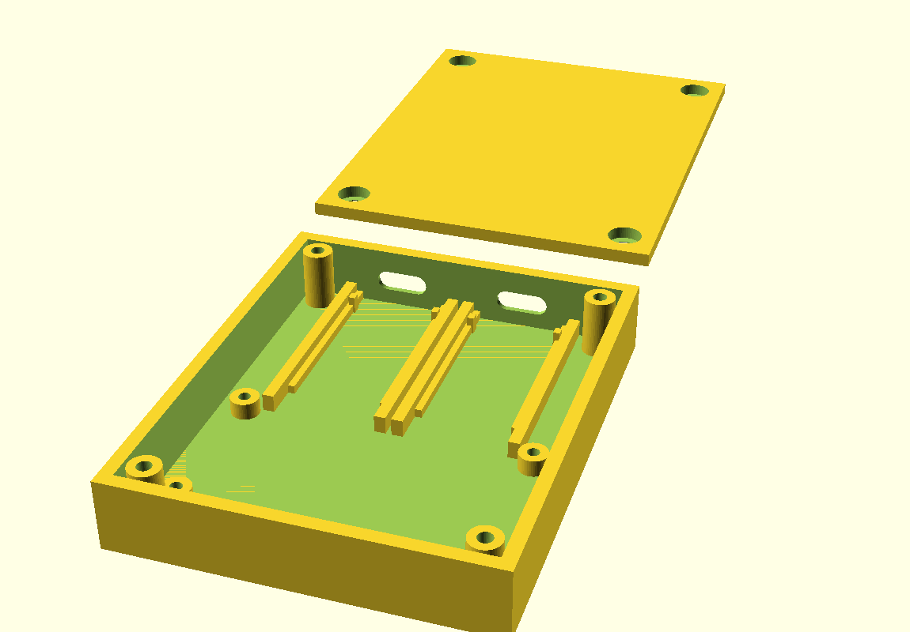

# Enclosure

> **Out of date since 2026-10-27 (review-notes #25):** the input boards now face the port wall with their **native USB** port, whose shell is **proud**, not the flush PIO-USB port this box was built around, and their retention notches are now at the inner end. The port-opening and nub logic below describes the old orientation. The carrier build needs a new enclosure anyway.

## Status

| Part | State |
|---|---|
| Two-port USB-C wall + cradle **test coupon** (`usb_wall_test.scad`) | One printed part. Printed and fitted by the owner. |
| **Full enclosure** (`box.scad`) | Base + lid modelled, checks pass. **Dimensions still carry guesses** — see "Measure these". Not printed. |
| Shared dimensions (`boards.scad`) | Single source for every board number and enclosure fit value. |

**Layout decision:** both input ports side by side on one face; the ESP32's own USB-C stays inside (`docs/decisions.md`).

## Full enclosure



**Layout** (`docs/decisions.md`, 2026-10-22): everything mounts to the base. Two RP2350 boards in cradles at the front, ESP32 flat behind them on four standoffs. The lid carries no board — its only job is to press the RP boards down and close the box.

| | |
|---|---|
| Outside size | about **64.6 × 79.7 × 15.2 mm** |
| Halves held by | 4 × M3 self-tapping screws into printed bosses, 2.5 mm pilots |
| ESP32 held by | 4 screws into standoffs, through its own mounting holes. 2.1 mm pilots, sized for M2.5 |
| RP boards held by | Nubs in the edge notches (fore/aft and sideways) + lid press posts (down) |
| Antenna | At a back corner, over empty space. **Keep the wiring loom on the ESP32's USB-C side** |

### Where the lid is allowed to touch

The RP2350's castellated pads run 2.88–23.20 mm from the inner edge, so anything pressing on the board must stay in the pad-free zones: the inner 2.88 mm and the port-end 9.8 mm. Four press posts per board sit inside those, clear of both USB-C shells and of the retention notches.

A check enforces this: `pad_zone()` models the strip where pads — and therefore your soldered wires — live, and the lid must not intersect it. Widening a press pad into that strip fails the suite.

### Why the ESP32 is not on the lid

It was going to be, inverted on four standoffs. Keeping it on the base is simpler: the lid carries no wiring, so lifting it does not drag the ESP32 and its loom out of the box. Nothing stacks, which also keeps the antenna clear without any thought about what is underneath it.

### Known soft spots

| Item | Status |
|---|---|
| ESP32 mounting hole diameter | **2.6 mm**, owner by eye — M2.5 confirmed as the right size. Worth a caliper check before buying screws |
| ESP32 tallest component (`esp_top_h`) | **4.5 mm**, owner by eye. Sets the interior height. Worth a caliper check once the batteries are in |
| Self-tapping thread life | M3 into printed PETG lasts perhaps 10–20 cycles. You will open this box a lot during firmware bring-up. PETG is the better of the two here: it yields rather than cracking when a thread is overtightened |
| Lid stiffness | 2.4 mm over a ~75 mm span, supported at four corners. The press posts push back; if the lid bows, thicken it or add a fifth boss |
| Service gap | 6 mm between the RP boards and the ESP32 for wiring and the inline diodes, resistors and caps. No perfboard fits — the small parts go inline in the loom |

## Board dimensions in hand

| Board | Size | Source |
|---|---|---|
| Waveshare RP2350-USB-C (×2) | 33.00 × 17.50 mm, R2.00 corners. USB-C 8.90 mm wide, centred, **at both ends**. **Two retention notches** in the long edges at the port end: 1.50 deep × 2.00 long, 3.45 from the port edge | Size and corners: drawing (verified). Notches: measured off the drawing, ±0.15 mm — Waveshare does not dimension them |
| Waveshare ESP32-DEV-KIT-WROOM-32E-N4 | 53.80 × 27.94 mm. Four mounting holes at 50.04 × 25.40 mm centres. 19-pin headers, 2.54 mm pitch, 45.72 mm span, rows 24.94 mm apart. USB-C 8.95 mm wide on one short edge; **PCB antenna at the opposite end** | Waveshare dimensioned drawing (verified) |

Rough full-box estimate: the ESP32 sets the width, so about **62 × 72 × 20 mm** outside, boards flat, input ports on one short face. An estimate, not a model.

**Antenna rule:** the ESP32's antenna end must point at a wall with no wiring, no diodes and no USB cables crowding it, and no carbon-fibre-filled filament anywhere near.

## Test coupon


The wall is solid, the boards drop straight down onto the nubs, and their flush outer shells sit against the wall's inner face.

**What it's for:** a small print (about 59 × 37 × 13 mm) to check the port design before the full box.

- Do the USB-C shells line up with the wall openings?
- Do real cables seat fully?
- **Do two cable overmolds fit side by side?** The main risk of the chosen layout, and the reason the coupon prints both ports.
- **Do the nubs hold the boards against plug-in and pull-out force?**

### Retention: nubs in the floor

Two nubs rise from the cradle floor into the board's edge notches, flush with the board's top face.


| Force | Taken by |
|---|---|
| Pull-out (cable yanked outward) | Nub faces against the notch walls, in the plane of the PCB |
| Push-in (plugging in) | Nub faces against the other notch walls |
| Side to side | Nub sides in the notches, plus the cradle rails |
| Up and down | **Nothing on the coupon.** The lid does it in the full box |

This replaces two earlier attempts, both now deleted: a drop-in clip at the inner end (commit `755abec`), and a "staple" of pegs dropped into the notches from above (commit `730c92e`). Both are recoverable from git if needed.

### The wall stays a solid piece

Fixed nubs mean the board must come **straight down** — it cannot slide forward, because the notch would have to travel over the nub through solid PCB.

That would normally force the port opening to be slotted open at the top so a protruding shell could drop in. It doesn't here: **on the real board the exposed port's shell is flush with the board edge** (owner, boards in hand). Only the inner programming port is proud. A flush shell never has to thread into the wall, so the opening stays a closed, shell-shaped hole in a solid wall, and the board still drops straight down.

The two overhangs are now separate parameters, `usb_over_out` (0.00, measured) and `usb_over_in` (1.00, still to measure). The drop test encodes the dependency: set `usb_over_out` back to a proud value and it fails, because the closed wall would then block the board.

### How deep the plug can go

With a flush receptacle, the wall sits in front of the connector mouth, so a plug stops that far short of bottoming out. `mouth_recess` is the dial:

| `mouth_recess` | Result |
|---|---|
| 1.00 (current) | 1 mm of wall in front, shell-shaped opening — **the same geometry as the coupon already printed** |
| smaller | Plug seats deeper, less wall left around the opening |
| 0 | Pocket goes clean through: full insertion, but the opening becomes overmold-sized rather than shell-shaped |

**Open question:** did a cable fully click home on the coupon you printed? That print had the same 1 mm of wall in front. If yes, leave `mouth_recess` alone. If a cable felt short or loose, drop it to 0.6 and reprint just the wall end.

## Measure these

The boards are in hand, so these can stop being guesses. Each is a parameter at the top of `usb_wall_test.scad`.

| Parameter | Current value | What to measure |
|---|---|---|
| `pcb_t` | 1.60 mm (assumed) | Board thickness, away from any parts |
| `usb_h` | 3.26 mm (typical top-mount shell) | USB-C shell height, board top to shell top |
| `usb_over_out` | **0.00 mm (measured: flush)** | Done |
| `usb_over_in` | 1.00 mm (assumed) | How far the inner programming port's shell overhangs |
| `under_clear` | 1.5 mm (assumed) | Tallest part on the board's underside, if any |
| `notch_dep` | 1.50 mm (pixel-measured) | Notch depth into the long edge |
| `notch_len` | 2.00 mm (pixel-measured) | Notch length along the board |
| `notch_d` | 3.45 mm (pixel-measured) | Notch's near edge, from the port edge |

The notch numbers matter most now that they carry all the load, and they are the least trustworthy: Waveshare does not dimension them, and they are probably depanelling tabs, so the edges may be rough.

After editing:

1. Run `tests/check_fit.sh`. Every line should say `ok`, `clear` or `contact only`, exit code 0.
2. Re-export:

   ```
   openscad -o stl/usb_wall_test_coupon.stl -D 'part="coupon"' usb_wall_test.scad
   ```

   The checks read board numbers from the model through `p_*()` accessors, so there is nothing to keep in sync by hand.

## Printing

| Setting | Suggestion |
|---|---|
| File | `stl/usb_wall_test_coupon.stl` — one part, nothing loose |
| Orientation | As exported, sitting on its base |
| Supports | None. The port openings are short bridges, about 9 mm |
| Material | PETG (the owner's usual). **Not** carbon-fibre-filled — that rule matters most near the antenna in the final box |
| Layer height | 0.12–0.16 mm. The nubs are 1.2 × 1.7 mm in plan, so fine layers matter more than before |
| Walls | 3 or more perimeters |

## Test steps

1. Drop a board straight down into a cradle so the notches land over the nubs. It should not need sliding or forcing.
2. Repeat for the second board.
3. Plug in several different cables, including your thickest-housing one. For each:
   - Does it click fully in?
   - Does the board move fore and aft, or do the nubs hold it?
   - Does the plug housing hit the wall before the plug is fully in?
4. **Plug both ports at once with your two fattest cables.** Do the housings foul each other?
5. Wiggle a plugged-in cable up, down and sideways. Watch whether the board flexes or lifts.
6. Yank a cable out fast. Do the nubs hold, or do they shear?
7. Hold the board down with a finger while plugging, to simulate the lid. Does that change anything?

## Tuning parameters

| Symptom | Change |
|---|---|
| Nubs won't enter the notches, or the board rattles fore and aft | `notch_c` (default 0.15 per face), then the notch dimensions from your calipers |
| A nub shears off | Raise `notch_c` (a tight nub takes a side load it shouldn't), or thicken the board under it by lowering `under_clear` |
| Two cables foul each other at the wall | `pitch_extra` (default 3.0). Raising it widens the box |
| Board too tight or loose across the cradle | `fit` (default 0.20 per side) |
| Shell binds in the opening, or the gap looks sloppy | `hole_c` (default 0.25 per side) |
| Plug housing hits the wall before the plug is fully in | Raise `om_w` / `om_h` (13.0 × 7.2) |
| Plug does not click fully home | Lower `mouth_recess` (1.00 now; 0 removes all wall in front) |

## Files

| File | Contents |
|---|---|
| `usb_wall_test.scad` | Port test coupon. Set `part` to `preview` or `coupon`. |
| `stl/` | Exported print files: `box_base.stl`, `box_lid.stl`, `usb_wall_test_coupon.stl` |
| `box.scad` | Full enclosure. Set `part` to `preview`, `base`, `lid` or `open`. |
| `boards.scad` | Shared board dimensions and enclosure fit values. Edit MEASURE values **here only**. |
| `tests/check_fit.sh` | Coupon collision checks, including a straight-down drop test. |
| `tests/check_box.sh` | Enclosure collision checks: 9 guards, 19 collisions. Takes a couple of minutes. |
| `img/` | Preview renders |

### A note on the guards

`check_fit.sh` runs *guards* before the collision checks. A guard asserts that a
test solid is non-empty. Without them an empty solid makes every collision check
pass for the wrong reason — which has happened twice in this project, once from
a modelling bug and once from a probe that was too big.

The drop test is the one that earns its keep now: it sweeps the board and both
USB shells upward and checks nothing is in the way, which is what proves the
board can be lowered in without sliding. Breaks confirmed to fail the suite:

| Break | Catches |
|---|---|
| Make `usb_over_out` proud again (closed wall blocks the drop) | `check 24`, `check 25` |
| Set `notch_c` negative (nub too big) | `check 1`, `check 7`, `check 24`, `check 25` |
| Set `notch_dep` to 0 (notches gone) | `guard 17`, `guard 19` |
| Widen `om_w` past the port pitch | `guard 14` |

And the enclosure suite (`check_box.sh`, 9 guards + 19 collisions, a couple of minutes to run):

| Break | Catches |
|---|---|
| Extend an inner press pad over the castellated pads | `check 27`, `check 28` |
| Widen a press pad over a USB-C shell | `check 21`–`check 24` |
| Make `usb_over_out` proud (port wall blocks the drop) | `check 17`, `check 18` |

The wall-web probe has now been wrong three times — too big, then spanning the
whole wall, then left behind when the pocket moved. It derives its position
from `p_pocket()` rather than hand-computed numbers, which is why the last move
did not silently break it.
