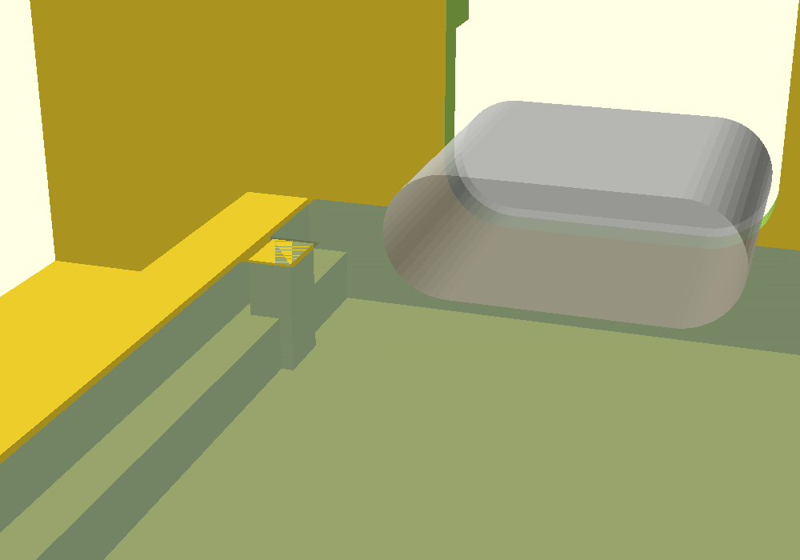

# Enclosure

## Status

| Part | State |
|---|---|
| Two-port USB-C wall + cradle **test coupon** (`usb_wall_test.scad`) | One printed part. Models and checks pass. **Dimensions still carry guesses** — see "Measure these". |
| Full enclosure | Not started. Waits on the coupon results. |

**Layout decision:** both input ports side by side on one face; the ESP32's own USB-C stays inside (`docs/decisions.md`).

## Board dimensions in hand

| Board | Size | Source |
|---|---|---|
| Waveshare RP2350-USB-C (×2) | 33.00 × 17.50 mm, R2.00 corners. USB-C 8.90 mm wide, centred, **at both ends**. **Two retention notches** in the long edges at the port end: 1.50 deep × 2.00 long, 3.45 from the port edge | Size and corners: drawing (verified). Notches: measured off the drawing, ±0.15 mm — Waveshare does not dimension them |
| Waveshare ESP32-DEV-KIT-WROOM-32E-N4 | 53.80 × 27.94 mm. Four mounting holes at 50.04 × 25.40 mm centres. 19-pin headers, 2.54 mm pitch, 45.72 mm span, rows 24.94 mm apart. USB-C 8.95 mm wide on one short edge; **PCB antenna at the opposite end** | Waveshare dimensioned drawing (verified) |

Rough full-box estimate: the ESP32 sets the width, so about **62 × 72 × 20 mm** outside, boards flat, input ports on one short face. An estimate, not a model.

**Antenna rule:** the ESP32's antenna end must point at a wall with no wiring, no diodes and no USB cables crowding it, and no carbon-fibre-filled filament anywhere near.

## Test coupon


**What it's for:** a small print (about 59 × 37 × 13 mm) to check the port design before the full box.

- Do the USB-C shells line up with the wall openings?
- Do real cables seat fully?
- **Do two cable overmolds fit side by side?** The main risk of the chosen layout, and the reason the coupon prints both ports.
- **Do the nubs hold the boards against plug-in and pull-out force?**

### Retention: nubs in the floor

Two nubs rise from the cradle floor into the board's edge notches, flush with the board's top face.



| Force | Taken by |
|---|---|
| Pull-out (cable yanked outward) | Nub faces against the notch walls, in the plane of the PCB |
| Push-in (plugging in) | Nub faces against the other notch walls |
| Side to side | Nub sides in the notches, plus the cradle rails |
| Up and down | **Nothing on the coupon.** The lid does it in the full box |

This replaces two earlier attempts, both now deleted: a drop-in clip at the inner end (commit `755abec`), and a "staple" of pegs dropped into the notches from above (commit `730c92e`). Both are recoverable from git if needed.

### Why the wall is three pillars

Fixed nubs mean the board must come **straight down** — it cannot slide forward into a closed hole, because the notch would have to travel over the nub through solid PCB. Any nub short enough to allow the slide leaves about 1.5 mm of play afterwards, which defeats the point.

So each port opening is **slotted open to the top of the wall**, and the USB-C shell drops in from above. That leaves the wall as three pillars on the coupon. In the full box the lid caps the slots and the openings become closed holes again.

The cost is that until the lid is on, only the lower half of each opening guides the plug. The alternative considered was a separate front face plate fitted after the boards; that keeps closed holes at the price of an extra part and joint.

## Measure these

The boards are in hand, so these can stop being guesses. Each is a parameter at the top of `usb_wall_test.scad`.

| Parameter | Current value | What to measure |
|---|---|---|
| `pcb_t` | 1.60 mm (assumed) | Board thickness, away from any parts |
| `usb_h` | 3.26 mm (typical top-mount shell) | USB-C shell height, board top to shell top |
| `usb_over` | 1.03 mm (the QT Py's value) | How far the shell overhangs the board edge |
| `under_clear` | 1.5 mm (assumed) | Tallest part on the board's underside, if any |
| `notch_dep` | 1.50 mm (pixel-measured) | Notch depth into the long edge |
| `notch_len` | 2.00 mm (pixel-measured) | Notch length along the board |
| `notch_d` | 3.45 mm (pixel-measured) | Notch's near edge, from the port edge |

The notch numbers matter most now that they carry all the load, and they are the least trustworthy: Waveshare does not dimension them, and they are probably depanelling tabs, so the edges may be rough.

After editing:

1. Run `tests/check_fit.sh`. Every line should say `ok`, `clear` or `contact only`, exit code 0.
2. Re-export:

   ```
   openscad -o stl/usb_wall_test_coupon.stl -D 'part="coupon"' usb_wall_test.scad
   ```

   The checks read board numbers from the model through `p_*()` accessors, so there is nothing to keep in sync by hand.

## Printing

| Setting | Suggestion |
|---|---|
| File | `stl/usb_wall_test_coupon.stl` — one part, nothing loose |
| Orientation | As exported, sitting on its base |
| Supports | None. The port openings are now slots open to the top, so there is nothing to bridge |
| Material | PLA or PETG for the test. **Not** carbon-fibre-filled (that rule matters most near the antenna in the final box) |
| Layer height | 0.12–0.16 mm. The nubs are 1.2 × 1.7 mm in plan, so fine layers matter more than before |
| Walls | 3 or more perimeters |

## Test steps

1. Drop a board straight down into a cradle so the notches land over the nubs. It should not need sliding or forcing.
2. Repeat for the second board.
3. Plug in several different cables, including your thickest-housing one. For each:
   - Does it click fully in?
   - Does the board move fore and aft, or do the nubs hold it?
   - Does the plug housing hit the wall before the plug is fully in?
4. **Plug both ports at once with your two fattest cables.** Do the housings foul each other?
5. Wiggle a plugged-in cable up, down and sideways. Watch whether the board flexes or lifts.
6. Yank a cable out fast. Do the nubs hold, or do they shear?
7. Hold the board down with a finger while plugging, to simulate the lid. Does that change anything?

## Tuning parameters

| Symptom | Change |
|---|---|
| Nubs won't enter the notches, or the board rattles fore and aft | `notch_c` (default 0.15 per face), then the notch dimensions from your calipers |
| A nub shears off | Raise `notch_c` (a tight nub takes a side load it shouldn't), or thicken the board under it by lowering `under_clear` |
| Two cables foul each other at the wall | `pitch_extra` (default 3.0). Raising it widens the box |
| Board too tight or loose across the cradle | `fit` (default 0.20 per side) |
| Shell binds in the opening, or the gap looks sloppy | `hole_c` (default 0.25 per side) |
| Plug housing hits the wall before the plug is fully in | Raise `om_w` / `om_h` (13.0 × 7.2), or set `mouth_recess` negative |

## Files

| File | Contents |
|---|---|
| `usb_wall_test.scad` | Parametric model. Set `part` to `preview` or `coupon`. |
| `stl/` | Exported print file |
| `tests/check_fit.sh` | Collision checks, including a straight-down drop test. Needs `openscad` and Python `trimesh`. |
| `img/` | Preview renders |

### A note on the guards

`check_fit.sh` runs *guards* before the collision checks. A guard asserts that a
test solid is non-empty. Without them an empty solid makes every collision check
pass for the wrong reason — which has happened twice in this project, once from
a modelling bug and once from a probe that was too big.

The drop test is the one that earns its keep now: it sweeps the board and both
USB shells upward and checks nothing is in the way, which is what proves the
board can be lowered in without sliding. Breaks confirmed to fail the suite:

| Break | Catches |
|---|---|
| Remove the wall's drop slot | `check 24`, `check 25` |
| Set `notch_c` negative (nub too big) | `check 1`, `check 7`, `check 24`, `check 25` |
| Set `notch_dep` to 0 (notches gone) | `guard 17`, `guard 19` |
| Widen `om_w` past the port pitch | `guard 14` |
